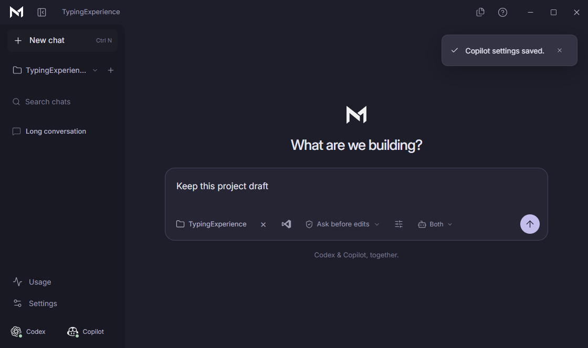

  
  <h1>Kugenie</h1>
  
A little space to build.

  
AI chat and coding with Codex and GitHub Copilot, together on Windows.

  
<a href="https://github.com/Kujiin/Kugenie-Releases/releases/latest/download/Kugenie-Setup.exe"><strong>Download for Windows</strong></a> · <a href="https://github.com/Kujiin/Kugenie-Releases/releases">Release notes</a> · <a href="https://github.com/Kujiin/Kugenie-Releases/issues">Report a problem</a>

  
Windows x64 · Early release · By Kujin™

## A workspace for your ideas

Ask questions, work on a project, and review proposed changes alongside your code editor. Kugenie brings your conversations and AI coding workflow into one desktop app.

- **Choose your agents.** Use Codex, Copilot, or both.
- **Stay in control.** Review file changes before approving them. Optional Full access allows direct edits and commands.
- **Keep your place.** Search saved chats, choose project context, and follow live task activity.

Built for students, hobbyists, and developers who want a simple place to work with AI.

## Get started

1. [Download Kugenie-Setup.exe](https://github.com/Kujiin/Kugenie-Releases/releases/latest/download/Kugenie-Setup.exe) and run it on a 64-bit Windows PC.
2. Open Kugenie and select **Setup**.
3. Follow the steps to install and sign in to your chosen providers.
4. Select **Check connections**, then start a chat or add a project folder.

You need your own eligible Codex or GitHub Copilot access. Provider usage limits apply. The installer is unsigned, so Windows may show a security warning.

## Try a first request

- “Explain how this project works.”
- “Help me find the cause of this error.”
- “Suggest improvements, and let me review the changes.”

## Help and feedback

[Read the latest release notes](https://github.com/Kujiin/Kugenie-Releases/releases/latest) for changes and known issues. [Open an issue](https://github.com/Kujiin/Kugenie-Releases/issues) to report a problem or suggest a feature. Please leave out passwords, tokens, and private project content.

## Ownership

Kugenie is owned and developed by **Kujin™**.

© 2026 Kujin™. All rights reserved. The Kugenie name, logo, and original branding belong to Kujin™. Third-party names, logos, and software belong to their respective owners.

This repository contains public downloads, images, and user information. Kugenie's application source remains private. GitHub's automatic source archives contain only the files in this public repository.
